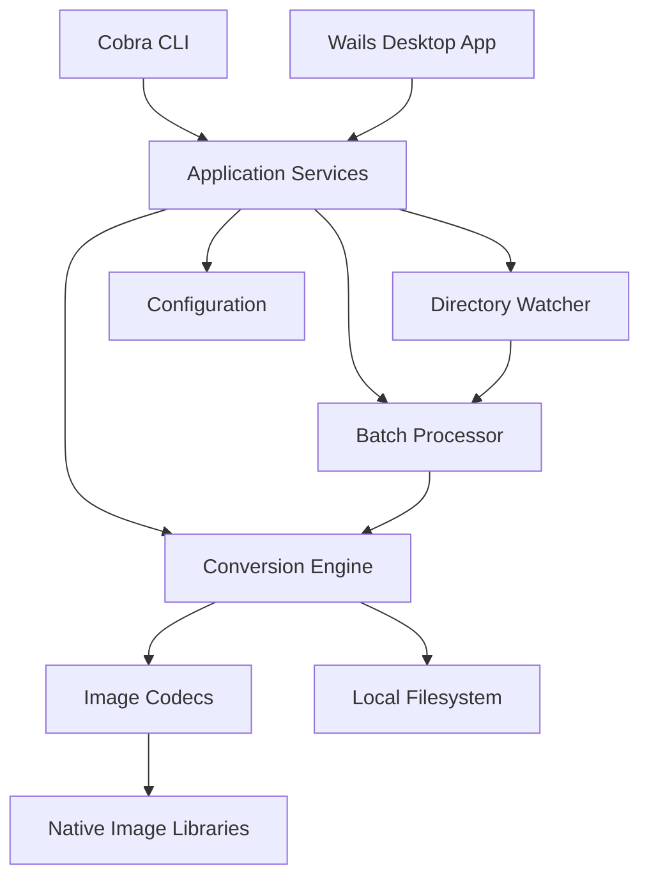
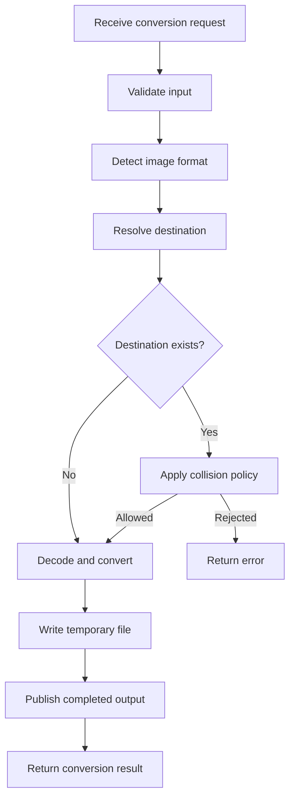

# FmtShift Architecture

## 1. Overview

FmtShift is a local-first, cross-platform file conversion utility written in Go.

The architecture consists of a shared conversion engine, a CLI, a directory monitoring service and a future desktop application.

All file processing takes place locally on the user's device. No external servers, databases or internet connections are required.

## 2. Technology Stack

| Component | Technology |
|---|---|
| Language | Go |
| CLI | Cobra |
| Image processing | libvips 8.15+ through cgo, behind a codec interface |
| HEIC decoding | libheif (via libvips), HEVC decoding by libde265 |
| Directory monitoring | fsnotify |
| Configuration | JSON |
| Logging | Go slog |
| Desktop application | Wails |
| CI/CD | GitHub Actions |
| Release automation | GoReleaser |

## 3. System Architecture



The CLI and desktop application must share the same application services and conversion engine.

Business logic must not be implemented inside CLI commands or desktop UI components.

## 4. Project Structure

```text
fmtshift/
├── cmd/
│   └── fmtshift/
│       └── main.go
├── internal/
│   ├── cli/
│   ├── app/
│   ├── converter/
│   │   ├── converter.go
│   │   ├── options.go
│   │   └── result.go
│   ├── codecs/
│   │   ├── codec.go         # Codec interface, capabilities, errors
│   │   └── vips/            # libvips adapter (cgo + small C pipeline)
│   ├── format/              # format names and content-based detection
│   ├── batch/
│   ├── watcher/
│   ├── config/
│   ├── filesystem/
│   └── version/
├── desktop/
├── testdata/
│   └── images/
├── scripts/
├── docs/
├── .github/
│   └── workflows/
├── .goreleaser.yaml
├── go.mod
├── go.sum
├── AGENTS.md
├── README.md
└── LICENSE
```

The desktop directory will be introduced when desktop development begins.

## 5. Component Responsibilities

### 5.1 CLI

Responsible for:
- Parsing commands and flags.
- Loading configuration.
- Calling application services.
- Displaying results and errors.
- Returning appropriate exit codes.

The CLI must not contain image processing logic.

### 5.2 Application Services

Responsible for coordinating:
- Single-file conversion.
- Batch conversion.
- Directory monitoring.
- Configuration management.
- Progress reporting and cancellation.

This layer provides the interface used by both the CLI and the future desktop application.

### 5.3 Conversion Engine

The conversion engine is responsible for validating conversion requests, detecting input formats, invoking the appropriate codec and producing destination files safely.
The engine must remain independent of Cobra and Wails.

Example interface:

```go
type Converter interface {
    Convert(
        ctx context.Context,
        request ConversionRequest,
    ) (ConversionResult, error)
}
```

### 5.4 Image Codecs

The codec layer abstracts image processing libraries from the conversion engine.

Initial supported formats:

| Format | Decode | Encode |
|---|---|---|
| HEIC / HEIF | Yes | No |
| JPEG | Yes | Yes |
| PNG | Yes | Yes |
| WebP | Yes | Yes |

#### Codec decision (M0)

**Selected:** libvips through cgo, with HEIC decoding by libvips' libheif
module. The adapter is a small C pipeline (`internal/codecs/vips`) rather than
a third-party Go binding, because libvips' variadic C API cannot be called
from Go directly and the pipeline needs only a handful of operations.

**Rejected:** a CGo-free build (Go standard library JPEG/PNG plus embedded
Wasm HEIC/WebP codecs). It would give self-contained binaries and trivial
cross-compilation, but libvips was preferred for decoding performance and
for mature colour management (lcms2) and metadata handling, which the
CGo-free path would have had to rebuild. The codec interface keeps this
option open if packaging proves unworkable.

Pipeline behaviour, verified by integration tests against synthetic fixtures:

- Inputs are loaded with the explicit loader for the detected format; content
  sniffing is not used, and loaders libvips marks as untrusted are blocked.
- The source is opened once. The content check, HEIF colour inspection and
  decoding all read that one descriptor, so replacing the path mid-conversion
  cannot pair one file's colour policy with another file's pixels.
- libvips keeps errors in one process-wide buffer. Conversions run
  concurrently under a shared lock and never read it; a failed conversion is
  retried once under an exclusive lock and reports only that retry's message.
  libvips warnings (the only diagnostics for some libpng failures) are routed
  into the buffer rather than printed to stderr.
- libheif applies HEIF `irot`/`imir` transforms and libvips removes the stale
  orientation tag; `vips_autorot` then applies EXIF orientation for other
  formats. Kept EXIF has orientation 1.
- Inputs with more than one top-level image or frame are rejected; HEIF
  thumbnails and auxiliary images are ignored.
- JPEG output composites alpha onto white.
- Metadata (EXIF, XMP, IPTC, ICC) is kept by default and pixels stay in their
  embedded colour space. When metadata is stripped, pixels are first converted
  to sRGB so colours survive losing the profile.
- HEIF colour signalling is read directly from libheif, because libvips does
  not expose NCLX boxes and would otherwise treat every NCLX image as sRGB.
  The v0.1 policy (`internal/codecs/vips/colour.go`):
  - **HDR (PQ or HLG transfer) is rejected** with `ErrHDR`, even when an ICC
    profile is present. Tone mapping to SDR is future work.
  - An embedded ICC profile otherwise takes precedence over NCLX.
  - NCLX Display P3 (primaries 12) without ICC gets libvips' built-in P3
    profile attached, so it is kept or converted to sRGB correctly.
  - NCLX BT.709/BT.601/unspecified primaries are treated as sRGB.
  - Other primaries (e.g. BT.2020 SDR) or unusual transfer functions without
    an ICC profile are rejected with `ErrColourSpace`.
- 10-bit SDR input is reduced to 8 bits for JPEG/WebP by libvips.
- HDR gain maps (as in typical iPhone HDR photos, whose base image is SDR)
  are not written; outputs contain the SDR base image.
- A pixel limit (default ~268 MP) is checked before full decoding.
- Outputs are created with mode 0666 minus the user's umask, like any new
  file; libvips writes into the prepared temporary file in place.

Measurements (Apple M4 Pro, libvips 8.18.7, synthetic 4032×3024 photo-like
HEIC of 3.2 MB; `make bench`):

| Conversion | Time | Peak RSS | Output |
|---|---|---|---|
| HEIC → JPEG (Q85) | 0.53 s | 242 MB | 1.7 MB |
| HEIC → PNG | 1.15 s | 180 MB | 23 MB |
| HEIC → WebP (Q85) | 1.12 s | 241 MB | 1.1 MB |
| 10-bit SDR HEIC → JPEG | 0.55 s | – | – |

The 10-bit benchmark input is SDR (no PQ/HLG, no gain map); it measures
10-bit decoding cost only and says nothing about HDR handling.

Batch throughput (HEIC → JPEG): 23 MP/s with 1 worker, 37 MP/s with 2 and
56 MP/s with 4, so a single conversion is largely single-threaded (libheif
decode) and Go workers provide most of the parallelism. Process start-up
costs about 40 ms, and reading HEIF colour signalling adds about 10 ms per
12 MP conversion. The release binary is 2.6 MB plus shared libraries.

Known issues and open items:

- Homebrew's libheif links the GPL x265 encoder, so its libraries cannot be
  bundled in a release as-is. A release needs a decode-only libheif build or
  must depend on a package manager's libvips.
- HEVC is patent-encumbered; some projects (e.g. sharp) and distributions
  ship without HEVC decoding for this reason. Distribution of libde265 must be
  reviewed before release. On macOS, Apple's ImageIO is a possible HEIC
  decoder that avoids shipping one.
- Homebrew installs libvips' dependency libarchive keg-only; the Makefile adds
  it to `PKG_CONFIG_PATH`.
- Homebrew's libvips pulls in ~90 packages (ImageMagick, poppler, etc.); a
  release should link a minimal libvips.
- libvips has no cheap cancellation; context is checked before each
  conversion only.
- A failed conversion briefly blocks all others while it is retried for its
  diagnostic message. Failures are expected to be rare; a batch of many
  corrupt files would run serially.
- NCLX handling and HDR rejection are verified with synthetic fixtures only.
  Not yet verified with real camera files: iPhone images carrying both `irot`
  and EXIF orientation, HDR gain maps, and PQ/HLG HEICs from Android phones
  and cameras.
- HDR to SDR tone mapping is not implemented; HDR inputs are rejected.

HEIF decoding must select the primary image. Thumbnails, depth maps, gain maps
and other auxiliary images are ignored in v0.1; true sequences and containers
with multiple top-level user images are rejected clearly.

Decoded pixels must be physically upright. HEIF container transforms are
applied exactly once, and preserved EXIF orientation is normalized to 1.
Colour handling must either preserve a compatible embedded profile or perform
a colour-managed conversion to sRGB. HDR-to-SDR and bit-depth reduction must
be explicit, deterministic and documented.

Native library compatibility, packaging requirements and licensing must be validated on all target operating systems before release.

### 5.5 Batch Processor

Responsible for:
- Discovering supported input files.
- Creating conversion jobs.
- Managing a bounded worker pool.
- Handling conversion failures independently.
- Reporting conversion progress and results.
- Supporting cancellation.

The default worker count should be conservative and configurable.

### 5.6 Directory Watcher

Uses fsnotify to monitor configured directories and submit conversion jobs when new supported files appear.

Responsibilities:
- Detect file creation and rename events.
- Wait until files are fully written.
- Deduplicate repeated filesystem events.
- Prevent conversion loops.
- Apply optional input format filters.
- Handle directory changes gracefully.
- Support cancellation and shutdown.

Recursive monitoring must be implemented explicitly because filesystem watchers do not necessarily monitor subdirectories automatically.

### 5.7 Configuration

Stores persistent user preferences, including:
- Default output format.
- Default quality.
- Output directory.
- Worker count.
- Metadata preferences.

Configuration precedence:
1. Explicit CLI flags.
2. User configuration.
3. Application defaults.

Implemented in `internal/config`. Example file (unset keys are omitted and
fall back to defaults):

```json
{
  "version": 1,
  "format": "png",
  "quality": 90,
  "workers": 4,
  "output": "/Users/me/Pictures/Converted",
  "stripMetadata": true
}
```

Overwrite is intentionally not configurable: a saved "overwrite" would make
every later command replace files with no visible flag. `output` is stored as
an absolute path so a saved default does not change meaning with the current
directory. Unknown keys, invalid values and unsupported versions make the
file invalid; an invalid file is reported (exit 3) and never rewritten.
Updates hold an exclusive file lock (flock on Unix) across read-modify-write
and save atomically via temporary file and rename. `FMTSHIFT_CONFIG`
overrides the location (used by tests to isolate the user's real settings).

Use platform-appropriate user configuration directories (`os.UserConfigDir`).

| Platform | Configuration location |
|---|---|
| macOS | ~/Library/Application Support/fmtshift |
| Linux | $XDG_CONFIG_HOME/fmtshift or ~/.config/fmtshift |
| Windows | %APPDATA%\fmtshift |

## 6. Conversion Lifecycle



The original file must remain unchanged.

Temporary files must be created on the destination filesystem to support safe publication of completed conversions.

Destination publication must respect the overwrite policy even when multiple jobs run concurrently.

## 7. Data Models

```go
type Format string

const (
    FormatHEIC Format = "heic"
    FormatJPEG Format = "jpeg"
    FormatPNG  Format = "png"
    FormatWebP Format = "webp"
)
```

`internal/converter` defines the engine's request and result:

```go
type Request struct {
    SourcePath      string
    Format          format.Format
    OutputDir       string // "" = source directory
    CreateOutputDir bool
    Quality         int    // 0 = DefaultQuality (85)
    Overwrite       bool
    StripMetadata   bool
    MaxPixels       int64  // 0 = codec default
}

type Result struct {
    SourcePath, OutputPath     string
    SourceFormat, OutputFormat format.Format
    SourceSize, OutputSize     int64
    Duration                   time.Duration
}
```

Every optional field's zero value is the safe default. Metadata is
expressed as `StripMetadata` rather than `PreserveMetadata` so that an unset
field keeps metadata. The output name is the source name with its last
extension replaced (`IMG 1.HEIC` → `IMG 1.jpg`).

These models are shared across the application layers and must not depend on a specific user interface.

## 8. Error Handling

Every error from `converter.Convert` matches exactly one kind with
`errors.Is`, and also wraps its underlying OS or codec error:

| Kind | Meaning |
|---|---|
| `ErrInvalidOptions` | Bad request: quality, unwritable format, output path not a directory |
| `ErrNotFound` | Source or output directory missing |
| `ErrPermission` | Access denied |
| `ErrUnsupportedInput` | Not a supported image, or multi-image, HDR, unsupported colour space, too large |
| `ErrCorrupt` | Looks like a supported format but cannot be decoded |
| `ErrSameFormat` | Already in the target format; skipped |
| `ErrOutputExists` | Destination exists and overwrite is off |
| `ErrSourceIsOutput` | Destination is the source itself (misnamed file, symlink, hard link or case-insensitive match); refused even with overwrite |
| `ErrConversionFailed` | Encoding or unexpected I/O failure |
| `ErrCancelled` | Context cancelled; nothing published |

"Unsupported codec" from earlier drafts maps to `ErrInvalidOptions` (cannot
write the requested format) or `ErrUnsupportedInput` (cannot read the source).

The engine opens the source exactly once (non-blocking on Unix, so a FIFO
cannot hang it) and passes that `*os.File` to the codec. Identity, size,
format detection, the source-is-output check and decoding therefore all
concern the same file, even if the path is replaced or a symlink retargeted
mid-conversion. Codecs must read only through the handle. Source I/O causes
(`ErrNotExist`, `ErrPermission`) are classified before codec kinds, and every
returned `Result`, including on error, carries `Duration`.

Outputs are published from a temporary file in the destination directory:
by hard link when overwrite is off (fails atomically if the destination
appeared meanwhile) and by rename when it is on. Both replace directory
entries only, so a destination that is a link to the source can never cause
the source's contents to be overwritten.

Batch operations should continue when individual conversions fail and return a summary containing successful, skipped and failed files.

## 9. Concurrency and Resource Management

- Use a bounded worker pool for batch conversion.
- Avoid loading an entire directory of images into memory.
- Limit simultaneous image processing operations.
- Propagate cancellation using context.Context.
- Validate image dimensions and resource limits before decoding
  where supported.
- Release native image processing resources after each job.
- Coordinate native library concurrency with Go worker counts.

## 10. Privacy and Reliability

- All conversions must happen locally.
- No mandatory telemetry.
- No upload of images or metadata.
- Originals must be preserved by default.
- Failed conversions must not leave incomplete output files.
- Metadata preservation and removal must be configurable.
- Native dependencies must be kept up to date.

## 11. Cross-Platform Distribution

FmtShift will be compiled and packaged for:

| OS | Architecture | Planned distribution |
|---|---|---|
| macOS | ARM64, AMD64 | GitHub Releases in v0.1; Homebrew in v0.2 |
| Windows | AMD64 | Deferred to v0.2; GitHub Releases, later WinGet |
| Linux | AMD64, ARM64 | GitHub Releases, later APT |

FmtShift links libvips through cgo, so every target is built on a native CI
runner (or with a target C toolchain) against that platform's libvips.

Each release must either bundle compatible native libraries or install them
through a package manager, and must state which model it uses. The packaging
model for each platform is still to be decided; see the known issues in
§5.4 (GPL x265 in Homebrew's libheif, HEVC patents, dependency size).

Users should not need to install Go to use a published release.

## 12. Desktop Application

The desktop application will be built with Wails.

It will communicate directly with the Go application services through Wails bindings.

Initial desktop features:
- Drag-and-drop file conversion.
- Batch conversion.
- Conversion progress.
- Format and quality selection.
- Directory watch management.
- Local conversion history.
- Optional background operation.

The desktop application will reuse the Go conversion engine rather than invoking the CLI as a subprocess.

Platform-specific behavior, including system tray support and automatic startup, will be isolated behind platform adapters.

## 13. CI/CD

GitHub Actions will be responsible for:
- Formatting and linting.
- Unit tests.
- Integration tests.
- Cross platform build verification.
- Native codec compatibility tests.
- Release packaging.
- Artifact checksum generation.

GoReleaser will be evaluated for automated release publishing and Homebrew formula generation.

## 14. Architecture Principles

- Local-first and offline-capable.
- Simple installation.
- Separation of concerns.
- Reusable conversion engine.
- Safe filesystem operations.
- Bounded resource consumption.
- Cross-platform compatibility.
- Testable interfaces.
- Minimal dependencies.

## 15. Future Extensions

The conversion engine should support adding new formats and conversion capabilities without rewriting the application layers.

Potential future extensions include:
- AVIF and TIFF support.
- Image compression.
- Image resizing.
- PDF conversion.
- Audio and video conversion.
- Persistent background services.
