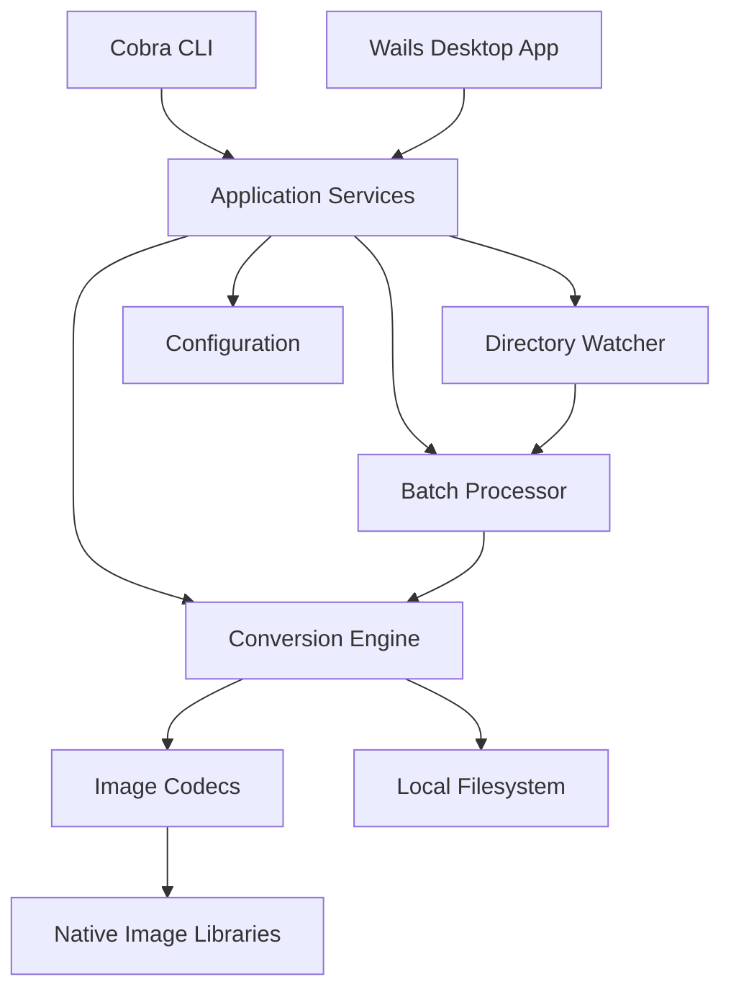
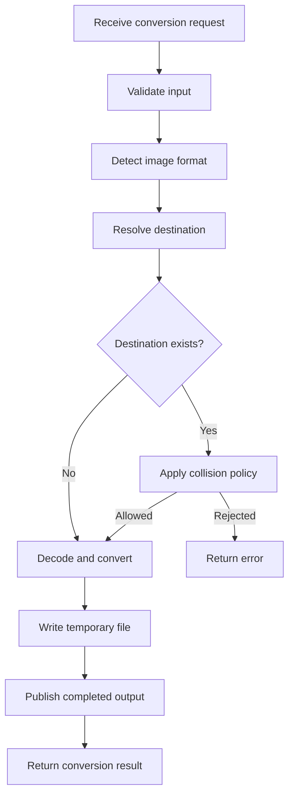

# FmtShift Architecture

## 1. Overview

FmtShift is a local-first, cross-platform file conversion utility written in Go.

The architecture consists of a shared conversion engine, a CLI, a directory monitoring service and a future desktop application.

All file processing takes place locally on the user's device. No external servers, databases or internet connections are required.

## 2. Technology Stack

| Component | Technology |
|---|---|
| Language | Go |
| CLI | Cobra |
| Image processing | Codec abstraction; implementation selected by M0 |
| HEIC decoding | M0 candidates: libvips/libheif and a CGo-free Go/Wasm path |
| Directory monitoring | fsnotify |
| Configuration | JSON |
| Logging | Go slog |
| Desktop application | Wails |
| CI/CD | GitHub Actions |
| Release automation | GoReleaser |

## 3. System Architecture



The CLI and desktop application must share the same application services and conversion engine.

Business logic must not be implemented inside CLI commands or desktop UI components.

## 4. Project Structure

```text
fmtshift/
├── cmd/
│   └── fmtshift/
│       └── main.go
├── internal/
│   ├── cli/
│   ├── app/
│   ├── converter/
│   │   ├── converter.go
│   │   ├── options.go
│   │   └── result.go
│   ├── codecs/
│   │   ├── registry.go
│   │   └── adapters/        # implementation selected by M0
│   ├── batch/
│   ├── watcher/
│   ├── config/
│   ├── filesystem/
│   └── version/
├── desktop/
├── testdata/
│   └── images/
├── scripts/
├── docs/
├── .github/
│   └── workflows/
├── .goreleaser.yaml
├── go.mod
├── go.sum
├── AGENTS.md
├── README.md
└── LICENSE
```

The desktop directory will be introduced when desktop development begins.

## 5. Component Responsibilities

### 5.1 CLI

Responsible for:
- Parsing commands and flags.
- Loading configuration.
- Calling application services.
- Displaying results and errors.
- Returning appropriate exit codes.

The CLI must not contain image processing logic.

### 5.2 Application Services

Responsible for coordinating:
- Single-file conversion.
- Batch conversion.
- Directory monitoring.
- Configuration management.
- Progress reporting and cancellation.

This layer provides the interface used by both the CLI and the future desktop application.

### 5.3 Conversion Engine

The conversion engine is responsible for validating conversion requests, detecting input formats, invoking the appropriate codec and producing destination files safely.
The engine must remain independent of Cobra and Wails.

Example interface:

```go
type Converter interface {
    Convert(
        ctx context.Context,
        request ConversionRequest,
    ) (ConversionResult, error)
}
```

### 5.4 Image Codecs

The codec layer abstracts image processing libraries from the conversion engine.

Initial supported formats:

| Format | Decode | Encode |
|---|---|---|
| HEIC / HEIF | Yes | No |
| JPEG | Yes | Yes |
| PNG | Yes | Yes |
| WebP | Yes | Yes |

M0 will compare two implementations behind the same codec interface:

1. libvips with libheif through cgo. This is the performance and feature-depth
   candidate, but requires target C toolchains and native-library packaging.
2. A CGo-free build using the Go standard library for JPEG and PNG plus
   embedded HEIC and WebP decoders/encoders. Candidate packages may use Wasm
   internally; “CGo-free” does not imply that the codec itself is written in
   Go.

The comparison must cover output correctness, orientation, alpha, ICC/NCLX
profiles, EXIF/XMP, Display P3, 10-bit and HDR input, performance, peak memory,
binary size, clean-machine installation, supported targets, security upkeep
and redistribution licenses. The selected implementation and rejected
alternatives will be recorded here after M0. Until then, no codec is an
architectural commitment.

HEIF decoding must select the primary image. Thumbnails, depth maps, gain maps
and other auxiliary images are ignored in v0.1; true sequences and containers
with multiple top-level user images are rejected clearly.

Decoded pixels must be physically upright. HEIF container transforms are
applied exactly once, and preserved EXIF orientation is normalized to 1.
Colour handling must either preserve a compatible embedded profile or perform
a colour-managed conversion to sRGB. HDR-to-SDR and bit-depth reduction must
be explicit, deterministic and documented.

Native library compatibility, packaging requirements and licensing must be validated on all target operating systems before release.

### 5.5 Batch Processor

Responsible for:
- Discovering supported input files.
- Creating conversion jobs.
- Managing a bounded worker pool.
- Handling conversion failures independently.
- Reporting conversion progress and results.
- Supporting cancellation.

The default worker count should be conservative and configurable.

### 5.6 Directory Watcher

Uses fsnotify to monitor configured directories and submit conversion jobs when new supported files appear.

Responsibilities:
- Detect file creation and rename events.
- Wait until files are fully written.
- Deduplicate repeated filesystem events.
- Prevent conversion loops.
- Apply optional input format filters.
- Handle directory changes gracefully.
- Support cancellation and shutdown.

Recursive monitoring must be implemented explicitly because filesystem watchers do not necessarily monitor subdirectories automatically.

### 5.7 Configuration

Stores persistent user preferences, including:
- Default output format.
- Default quality.
- Output directory.
- Worker count.
- Metadata preferences.

Configuration precedence:
1. Explicit CLI flags.
2. User configuration.
3. Application defaults.

Example configuration:

```json
{
  "version": 1,
  "format": "jpeg",
  "quality": 85,
  "workers": 2,
  "preserveMetadata": true,
  "overwrite": false
}
```

Use platform-appropriate user configuration directories.

| Platform | Configuration location |
|---|---|
| macOS | ~/Library/Application Support/fmtshift |
| Linux | $XDG_CONFIG_HOME/fmtshift or ~/.config/fmtshift |
| Windows | %APPDATA%\fmtshift |

## 6. Conversion Lifecycle



The original file must remain unchanged.

Temporary files must be created on the destination filesystem to support safe publication of completed conversions.

Destination publication must respect the overwrite policy even when multiple jobs run concurrently.

## 7. Data Models

```go
type Format string

const (
    FormatHEIC Format = "heic"
    FormatJPEG Format = "jpeg"
    FormatPNG  Format = "png"
    FormatWebP Format = "webp"
)
```

```go
type ConversionRequest struct {
    SourcePath       string
    OutputPath       string
    Format           Format
    Quality          int
    Overwrite        bool
    PreserveMetadata bool
}
```

```go
type ConversionResult struct {
    SourcePath  string
    OutputPath  string
    SourceSize  int64
    OutputSize  int64
    Duration    time.Duration
}
```

These models are shared across the application layers and must not depend on a specific user interface.

## 8. Error Handling

Define typed errors for common failure categories:
- File not found.
- Unsupported input format.
- Invalid conversion options.
- Unsupported codec.
- Corrupt image.
- Output already exists.
- Permission denied.
- Conversion failed.
- Conversion cancelled.

Batch operations should continue when individual conversions fail and return a summary containing successful, skipped and failed files.

## 9. Concurrency and Resource Management

- Use a bounded worker pool for batch conversion.
- Avoid loading an entire directory of images into memory.
- Limit simultaneous image processing operations.
- Propagate cancellation using context.Context.
- Validate image dimensions and resource limits before decoding
  where supported.
- Release native image processing resources after each job.
- Coordinate native library concurrency with Go worker counts.

## 10. Privacy and Reliability

- All conversions must happen locally.
- No mandatory telemetry.
- No upload of images or metadata.
- Originals must be preserved by default.
- Failed conversions must not leave incomplete output files.
- Metadata preservation and removal must be configurable.
- Native dependencies must be kept up to date.

## 11. Cross-Platform Distribution

FmtShift will be compiled and packaged for:

| OS | Architecture | Planned distribution |
|---|---|---|
| macOS | ARM64, AMD64 | GitHub Releases in v0.1; Homebrew in v0.2 |
| Windows | AMD64 | Deferred to v0.2; GitHub Releases, later WinGet |
| Linux | AMD64, ARM64 | GitHub Releases, later APT |

Native image processing dependencies introduce additional build and packaging
requirements. Cgo cross-compilation requires a target C toolchain and native
dependencies; builds may therefore use platform-specific CI runners. A
CGo-free selected codec should instead produce self-contained Go binaries.

Each release must either be self-contained, bundle compatible native
libraries, or install the required dependencies through a package manager.
The release must state which model it uses.

Native builds will use platform-specific CI runners where needed.

Users should not need to install Go to use a published release.

## 12. Desktop Application

The desktop application will be built with Wails.

It will communicate directly with the Go application services through Wails bindings.

Initial desktop features:
- Drag-and-drop file conversion.
- Batch conversion.
- Conversion progress.
- Format and quality selection.
- Directory watch management.
- Local conversion history.
- Optional background operation.

The desktop application will reuse the Go conversion engine rather than invoking the CLI as a subprocess.

Platform-specific behavior, including system tray support and automatic startup, will be isolated behind platform adapters.

## 13. CI/CD

GitHub Actions will be responsible for:
- Formatting and linting.
- Unit tests.
- Integration tests.
- Cross platform build verification.
- Native codec compatibility tests.
- Release packaging.
- Artifact checksum generation.

GoReleaser will be evaluated for automated release publishing and Homebrew formula generation.

## 14. Architecture Principles

- Local-first and offline-capable.
- Simple installation.
- Separation of concerns.
- Reusable conversion engine.
- Safe filesystem operations.
- Bounded resource consumption.
- Cross-platform compatibility.
- Testable interfaces.
- Minimal dependencies.

## 15. Future Extensions

The conversion engine should support adding new formats and conversion capabilities without rewriting the application layers.

Potential future extensions include:
- AVIF and TIFF support.
- Image compression.
- Image resizing.
- PDF conversion.
- Audio and video conversion.
- Persistent background services.
